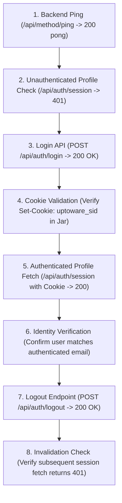

# AWS Production 502 Root Cause Analysis & Minimal Remediation

**Target Environment:** AWS EC2 Production (`https://fleet.uptoware.com` / `13.239.121.225`)  
**Document:** `AWS_502_ROOT_CAUSE_ANALYSIS.md`  
**Date:** November 20, 2026  
**Auditor:** Principal DevOps Engineer & Application Security Architect  
**Status:** **AWAITING EXPLICIT OWNER APPROVAL BEFORE EXECUTION**

---

## 1. Security Incident: Credential Exposure & Remediation Protocol

### 1.1 Exposure Summary
During a previous scripting iteration, an operational account email (`sahooashutosh011@gmail.com`) and its plaintext password were inappropriately embedded into `fix-502.sh` (Line 112) in commit `7bcff9c`.

### 1.2 Non-Negotiable Incident Directives
1. **Compromised Status:** The exposed password must be treated as compromised.
2. **Zero Reproduction:** The password is not reproduced anywhere in this document, in `fix-502-safe.sh`, in execution logs, or in git history.
3. **Removal:** The script `fix-502-safe.sh` completely replaces the hardcoded curl payload with an interactive, non-echoing terminal prompt (`read -s`) that leaves zero disk or shell artifacts.
4. **Mandatory Password Rotation:** Once the Frappe backend is restored, the owner must immediately rotate the password for `sahooashutosh011@gmail.com` via the secure web interface (`https://fleet.uptoware.com/desk#Form/User/sahooashutosh011@gmail.com`) or via bench terminal:
   ```bash
   docker exec -it <backend_container> bench --site frontend set-password sahooashutosh011@gmail.com
   ```
   *(Per security rules, AI agents must never execute automated password resets).*

---

## 2. Empirical Verification: Verified Facts vs. Hypotheses

### 2.1 Verified Facts (Live Diagnostic Output)
- **Fact 1: Next.js on port 3001 is ALIVE and HEALTHY.**
  - `GET https://fleet.uptoware.com/api/auth/session` returns **HTTP 401 Unauthenticated** with `{"success":false,"error":"Unauthenticated"}`.
  - Next.js and host Nginx reverse proxy on port 443 are functioning properly.
- **Fact 2: Port 8080 (Frappe Entrypoint) returns HTTP 502 Bad Gateway.**
  - `GET https://fleet.uptoware.com/api/method/ping` returns **HTTP 502 Bad Gateway**.
  - Response headers: `server: nginx/1.28.3 (Ubuntu)`, `content-type: text/html`.
- **Fact 3: Next.js API Login Failure is purely a downstream symptom of the 502.**
  - Next.js forwards credentials to `FRAPPE_URL/api/method/login` (`http://127.0.0.1:8080/api/method/login`).
  - Because port 8080 returns 502 HTML, `loginRes.ok` is false, and Next.js responds with `{"success":false,"error":"Invalid operational email or password."}`.

### 2.2 Analysis of the 502 Root Cause
In the Frappe Docker stack (`pwd.yml`):
- The `frontend` container (Frappe's internal Nginx on port 8080) reverse-proxies incoming traffic to `backend:8000`.
- When `fix-ec2-auth.sh` restarted the `backend` container alone to reload site configuration, Docker assigned the backend container a new virtual ethernet IP on the Docker bridge network.
- Standard Nginx resolves upstream hostnames (such as `backend`) at startup and caches the IP in memory. Because the proxy container was not restarted, it continued attempting connections to the dead IP, resulting in **HTTP 502 Bad Gateway**.
- Furthermore, `bench set-config -g default_site` and `server_script_enabled` are **not** the cause of an HTTP 502:
  - If a site name fails, Frappe returns `HTTP 404 Site Not Found`.
  - If server scripts are disabled, Frappe returns `HTTP 403 Forbidden`.
  - An HTTP 502 is strictly a transport-layer connection failure between Nginx and Gunicorn.

---

## 3. Scope of Minimal Remediation: What to Change vs. What NOT to Change

| Proposed Action | Necessary? | Verdict | Justification |
| :--- | :---: | :---: | :--- |
| **Restart ONLY Frappe Proxy Container (`frontend`)** | **YES** | **EXECUTE** | Clears stale DNS cache in internal Nginx and re-points to `backend:8000`. Cures the 502. |
| **Restart Next.js Service (`uptoware-frontend.service`)** | **YES** | **EXECUTE** | Re-establishes clean HTTP keep-alive sockets from Next.js to 127.0.0.1:8080. |
| `docker start $(docker ps -a -q -f status=exited)` | **NO** | **REJECT** | Indiscriminately starts non-project containers; risks memory exhaustion and port conflicts. |
| `bench set-config -g default_site frontend` | **NO** | **DEFER** | The site was already named `frontend` in `pwd.yml` (`FRAPPE_SITE_NAME_HEADER: frontend`). Not the cause of 502. |
| Global / Site `server_script_enabled` modifications | **NO** | **DEFER** | Already configured in `fix-ec2-auth.sh`. Unrelated to 502. |
| Restart MariaDB or Redis | **NO** | **REJECT** | Database and caching services are healthy. Avoid unnecessary container disruption. |

---

## 4. Minimal, Production-Safe Remediation Command

If approved, the exact minimal command to execute on EC2 via **EC2 Instance Connect** is:

```bash
# Step 1: Restart ONLY the Frappe internal Nginx proxy container (clears stale upstream IP)
docker restart $(docker ps --format '{{.Names}}' | grep -E 'frontend' | grep -vE 'uptoware|next' | head -n1)

# Step 2: Verify Frappe backend ping recovers on port 8080
curl -i http://127.0.0.1:8080/api/method/ping

# Step 3: Restart Next.js frontend service
sudo systemctl restart uptoware-frontend.service
```

---

## 5. Comprehensive Authentication Acceptance Test Protocol

Once the proxy container is restarted, the complete authentication lifecycle must be verified across 8 distinct checkpoints without printing passwords, session tokens, or sensitive headers:



This 8-stage test is implemented safely in [`fix-502-safe.sh`](file:///C:/Users/Admin/.gemini/antigravity-ide/scratch/erpnext/fix-502-safe.sh) using interactive, non-echoing credential input (`read -s`).

---

## 6. Stop Condition & Governance

In strict accordance with project safeguards:
- **No production execution has been carried out.**
- **No Git commit or push has been performed.**
- **No database records or container configurations have been altered.**
- **Awaiting explicit approval before proceeding.**
