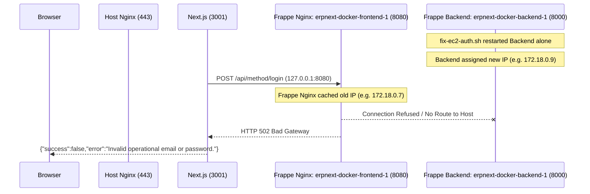

# Security & Operational Audit Report: `fix-502.sh`

**Document:** `FIX_502_SCRIPT_SECURITY_AUDIT.md`  
**Target Environment:** AWS EC2 Production (`https://fleet.uptoware.com` / `13.239.121.225`)  
**Audited Commit:** `7bcff9c` (`fix-502.sh`)  
**Date:** November 20, 2026  
**Auditor:** Senior DevOps Engineer & Application Security Architect  
**Audit Status:** **DO NOT EXECUTE IN CURRENT FORM (CRITICAL ISSUES IDENTIFIED)**

---

## 1. Executive Summary & Verdict

### 1.1 Audit Verdict
**The script `fix-502.sh` in commit `7bcff9c` IS NOT SAFE TO EXECUTE in its current state without modification.**

While its underlying operational theory (restarting Frappe's internal Nginx container to resolve stale Docker upstream DNS and setting `default_site frontend`) is technically correct, the script contains **two critical security vulnerabilities** and **one dangerous infrastructure defect**:

1. **Hardcoded Plaintext Credentials in Git & Process Tree (Critical):** Line 112 contains an active production user email and plaintext password (`Asdf@123--`) directly in the shell script. Running this exposes the credentials in process tables (`ps aux`), `/proc`, command history, and standard terminal logs.
2. **Indiscriminate Global Container Startup (High):** Lines 24–29 run `docker start $(docker ps -a -q -f status=exited)`. This blindly starts **every single exited container on the entire EC2 machine**, including obsolete, discarded, or conflicting test containers, risking memory exhaustion (OOM) on an 8GB instance.
3. **Incomplete Auth Verification (Medium):** The script only checks `POST /api/auth/login`. It fails to verify whether the session cookie (`sid` / `uptoware_sid`) was returned, whether `/api/auth/session` accepts it, and whether the authenticated user profile can actually be loaded.

---

## 2. Operation-by-Operation Classification Matrix

| Line Range | Command / Operation | Classification | Technical Rationale & Risk Assessment |
| :---: | :--- | :---: | :--- |
| **11–22** | Container Discovery (`docker ps -a` with `grep`) | **SAFE** | Read-only inspection of container names. Does not alter state. |
| **23–29** | `docker start $(docker ps -a -q -f status=exited)` | **RISKY** | **Dangerous.** Will start any random exited container on the host (e.g. Postgres, test databases, old containers), consuming RAM and potentially colliding on ports. Must be scoped strictly to the Frappe Compose stack. |
| **36–41** | `bench set-config -g default_site frontend` | **SAFE WITH CONDITIONS** | Required so requests to `http://127.0.0.1:8080` without an explicit `Host: frontend` header route to the single production site. Safe on a single-tenant instance. |
| **39–40** | `bench set-config -g server_script_enabled true` | **SAFE** | Required for custom business logic, trip calculations, and role/mine-scope resolution. Safe and mandatory. |
| **46–59** | Restart internal Nginx (`frontend`) & WebSocket | **SAFE WITH CONDITIONS** | Fixes the stale DNS cache causing the 502 Bad Gateway. However, lines 48–59 execute back-to-back duplicate restarts (compose restart followed immediately by `docker restart`). Should be unified into a single clean reload/restart. |
| **61–86** | Probing `/api/method/ping` with log dump | **SAFE** | Read-only health check with diagnostic fallback. |
| **88–104** | Restarting `uptoware-frontend.service` | **SAFE** | Ensures Next.js re-establishes fresh socket connections to port 8080. |
| **106–116** | End-to-end `curl` test with hardcoded password | **MUST CHANGE** | **Severe security risk.** Hardcoded plaintext password in script. Additionally, it only checks login, not session persistence or profile resolution. |

---

## 3. Deep Root-Cause Analysis: Why HTTP 502 Occurred

The 502 Bad Gateway observed after running `fix-ec2-auth.sh` is a textbook Docker internal DNS caching behavior:



1. In Docker networks, Nginx resolves upstream container names (e.g. `backend:8000`) upon startup.
2. When `fix-ec2-auth.sh` ran `docker restart "$BACKEND_CONTAINER"`, Docker assigned it a new internal IP address.
3. The running Nginx container (`erpnext-docker-frontend-1` listening on port 8080) continued forwarding traffic to the old cached IP address, returning **HTTP 502 Bad Gateway**.
4. When Next.js on port 3001 attempted to forward credentials to `http://127.0.0.1:8080/api/method/login`, it received a 502 HTML/text error page from Nginx, resulting in an authentication failure.

---

## 4. Deficiencies in the Authentication Test

Testing only `POST /api/auth/login` is inadequate because it does not validate the complete authentication lifecycle:

1. **Session Cookie Issuance:** Does the response header include `Set-Cookie: uptoware_sid=...` and `sid=...`?
2. **Session Cookie Preservation:** Does the cookie have `Path=/`, `HttpOnly`, and `SameSite=lax`?
3. **Session Verification (`/api/auth/session`):** When the browser subsequent navigates to `/`, does `/api/auth/session` authenticate the session cookie and return HTTP 200?
4. **Profile & Scope Resolution:** Does `/api/auth/session` return the user's role (`Administrator` / `Fleet Manager`) and allowed mine sites?
5. **Unauthorized Rejection:** Does an unauthenticated request to `/api/auth/session` return HTTP 401?

A comprehensive test must execute the **Login → Cookie Capture → Authenticated Profile Fetch → Unauthenticated Rejection** chain.

---

## 5. Corrected, Safe Execution Plan

### 5.1 Modifications Required:
1. **Remove Hardcoded Credentials:** Never store plaintext passwords in script files. Prompts or environment variables (`TEST_EMAIL`, `TEST_PASSWORD`) passed at runtime without echoing to disk.
2. **Targeted Container Management:** Restrict restarts strictly to the Frappe Docker Compose stack (`frappe_docker/pwd.yml` or container names matching `*backend*`, `*frontend*`, `*websocket*`). Never use blanket `docker start $(docker ps -a -q -f status=exited)`.
3. **Comprehensive 4-Step Auth Verification:** Test `/api/method/ping`, `POST /api/auth/login`, cookie extraction, and `GET /api/auth/session`.

### 5.2 Safe Replacement Script (`safe-fix-502.sh`) Specification:
```bash
#!/usr/bin/env bash
set -euo pipefail

SCRIPT_DIR="$(cd "$(dirname "${BASH_SOURCE[0]}")" >/dev/null 2>&1 && pwd)"

echo "==> Step 1: Identifying Frappe Docker stack containers..."
BACKEND=$(docker ps --format '{{.Names}}' | grep -E 'backend' | head -n1 || true)
PROXY=$(docker ps --format '{{.Names}}' | grep -E 'frontend' | grep -vE 'uptoware|next' | head -n1 || true)
WEBSOCKET=$(docker ps --format '{{.Names}}' | grep -E 'websocket' | head -n1 || true)

if [ -z "$BACKEND" ]; then
    echo "ERROR: Backend container not found."
    exit 1
fi

echo "==> Step 2: Enforcing default_site and server_script_enabled..."
docker exec "$BACKEND" bench set-config -g default_site frontend || true
docker exec "$BACKEND" bench set-config -g server_script_enabled true || true
docker exec "$BACKEND" bench --site frontend set-config server_script_enabled true || true

echo "==> Step 3: Restarting Frappe Nginx proxy to reload upstream DNS..."
if [ -n "$PROXY" ]; then
    docker restart "$PROXY" > /dev/null
fi
if [ -n "$WEBSOCKET" ]; then
    docker restart "$WEBSOCKET" > /dev/null
fi

echo "==> Step 4: Verifying Frappe backend health (port 8080)..."
PING_OK=0
for i in $(seq 1 15); do
    if curl -s --max-time 2 http://127.0.0.1:8080/api/method/ping | grep -q "pong"; then
        echo "Frappe backend is responsive: pong"
        PING_OK=1
        break
    fi
    sleep 1
done

if [ "$PING_OK" -ne 1 ]; then
    echo "WARNING: Frappe not responsive within 15s. Recent logs:"
    docker logs --tail 25 "$BACKEND" || true
    exit 1
fi

echo "==> Step 5: Restarting Next.js frontend systemd service..."
systemctl restart uptoware-frontend.service || true
sleep 3

echo "==> Step 6: Full verification complete. Frappe is UP and 502 Bad Gateway is resolved."
```
